# ClientPulse

<p align="center">
  
</p>

<p align="center">
  <strong>Learn the fundamentals. Build the features. Optimize the experience.</strong>
</p>

<p align="center">
  A Java and Fabric Minecraft client-side development project, built one feature at a time.
</p>

<p align="center">
  
  
  
  
  
</p>

---

## The Vision

Minecraft client development brings together programming, performance, user experience, and creativity.

**ClientPulse is my journey from writing Java code to building practical Minecraft client-side software.**

I'm using this project to deepen my understanding of Java, explore the Fabric modding ecosystem, and learn to design clean, modular, maintainable features.

My long-term ambition is to create a polished client-side experience and build a strong software development portfolio for future Java developer opportunities.

## Current Feature: FPS HUD

ClientPulse currently displays a small FPS counter in the top-left corner of the in-game HUD. The counter measures rendered frames over one-second intervals. Press **F8** to toggle it; the key can also be changed in **Options → Controls → Key Binds → ClientPulse**.

The dashboard banner is a **design concept**, not a claim that the pictured interface or its sample metrics are implemented. This FPS counter is the only performance metric currently implemented.

## Planned Features

| Feature | Purpose |
|---|---|
| FPS HUD | Display rendered FPS; toggle with a configurable keybind (F8 by default) |
| Customizable HUD | Configure supported on-screen elements |
| Feature management | Organize features into maintainable modules |
| Keybind support | Add configurable controls for implemented features |
| Settings interface | Centralize user configuration |
| Performance testing | Investigate the impact of implemented features |

These are plans. Mark a feature complete only after it has been implemented and tested.

## Technology Stack

- **Java** for programming and object-oriented design.
- **Fabric** for Minecraft mod development.
- **Gradle** for builds and dependency management.
- **IntelliJ IDEA** as the development environment.
- **Git and GitHub** for version control and project documentation.

The Minecraft, Java, Fabric Loader, Fabric API, and Loom versions are listed in `gradle.properties`. Check the official Fabric version selector before upgrading them.

## Development Roadmap

- [ ] Import the project into IntelliJ IDEA and sync Gradle.
- [ ] Run the Minecraft development client.
- [ ] Verify the ClientPulse startup message in the log.
- [x] Implement the first client-side feature: an FPS HUD.
- [ ] Establish a modular feature architecture.
- [x] Add FPS as the first performance metric.
- [ ] Develop configurable HUD elements.
- [x] Add a configurable keybind for toggling the FPS HUD.
- [ ] Add settings for HUD customization.
- [ ] Test features and investigate bugs.
- [ ] Improve code quality and documentation.

## Project Structure

```text
ClientPulse/
├── assets/
│   └── profile-banner.svg
├── src/
│   └── main/
│       ├── java/com/ruhioki/clientpulse/
│       │   ├── ClientPulseClient.java
│       │   └── hud/FpsHud.java
│       └── resources/
│           ├── assets/clientpulse/lang/en_us.json
│           └── fabric.mod.json
├── build.gradle
├── gradle.properties
├── settings.gradle
├── .gitignore
├── LICENSE
└── README.md
```

## Development Principles

- Write readable, maintainable Java.
- Prefer modular and reusable components.
- Understand the APIs behind each feature.
- Test changes in the actual development environment.
- Investigate performance rather than making unsupported claims.
- Document compatibility and design decisions.
- Respect the licenses and requirements of Minecraft, Fabric, and third-party libraries.

## About Me

**Mohamed | [@ruhioki](https://github.com/ruhioki)**

I'm an Artificial Intelligence and Data Science student interested in Java development, GPU technology, performance optimization, and Minecraft technology.

I'm building practical projects to strengthen my engineering skills and document my progress.

---

<p align="center">
  <strong>ClientPulse</strong><br/>
  <sub>Think like a developer. Build like a creator. Optimize every detail.</sub>
</p>
